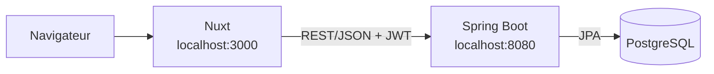
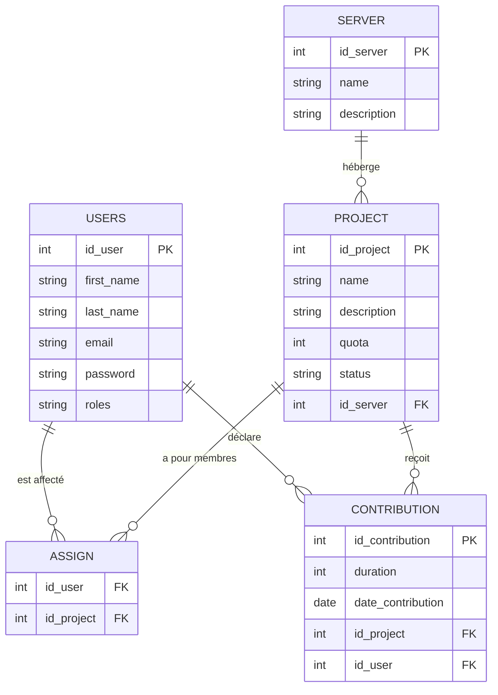

# DevSuivi — Suivi d'activités de développeurs

Projet d'Intégration Opérationnelle (3iL I3, septembre 2026).

Application web interne permettant :

- aux **développeurs** de déclarer leurs contributions (temps passé, en minutes, sur un projet) ;
- aux **responsables** de gérer les projets, les serveurs, les comptes et les affectations, et de suivre la charge de l'équipe.

## Structure du dépôt

| Dossier | Contenu | Technologies |
|---|---|---|
| [Back-End/](Back-End/) | API REST sécurisée par JWT | Java 25, Gradle, Spring Boot 4, JPA, PostgreSQL |
| [Front-End/](Front-End/) | Interface web | TypeScript, Node, Vue 3, Nuxt 4 |

Chaque dossier a son propre README avec les instructions détaillées : [Back-End](Back-End/README.md) et [Front-End](Front-End/README.md).

## Démarrage rapide

1. **Base de données** : créer une base PostgreSQL `dev_suivi` (utilisateur `postgres` / `postgres`), puis exécuter dans l'ordre :
   - `Back-End/src/main/resources/data/dev-suivi.sql` (création du schéma)
   - `Back-End/src/main/resources/data/init-dev-suivi.sql` (jeu de données de test)

2. **Back-End** (port 8080) :

   ```bash
   cd Back-End
   ./gradlew bootRun
   ```

3. **Front-End** (port 3000) :

   ```bash
   cd Front-End
   pnpm install
   pnpm dev
   ```

4. Ouvrir `http://localhost:3000` et se connecter avec un compte de test (voir [Back-End/README.md](Back-End/README.md#comptes-de-test)).

## Architecture



- Back-End en couches : `Controller` → `Service` → `Repository`, avec des DTO (records) et des mappers MapStruct.
- Authentification : `POST /auth/login` renvoie un access token JWT (HS256) et un refresh token. Le front stocke les jetons dans des cookies et les envoie dans l'en-tête `Authorization: Bearer ...`. `POST /auth/register` crée un compte développeur.
- Le code (routes, endpoints, noms de fichiers, identifiants) utilise l'anglais `project` ; l'interface reste en français.

## Modèle de données



`ASSIGN` est l'affectation développeur ↔ projet. `roles` contient une liste de rôles par utilisateur.

## Rôles

| Sujet | Code | Droits principaux |
|---|---|---|
| Responsable | `ADMIN` | Tout, y compris la gestion des comptes utilisateurs et des serveurs |
| Responsable | `MANAGER` | Projets, affectations, contributions de tous |
| Développeur | `DEVELOPER` | Ses projets, ses contributions, son profil |

Combinaisons autorisées : `ADMIN`, `MANAGER`, `ADMIN` + `MANAGER`, ou `DEVELOPER` seul. `DEVELOPER` ne se combine pas avec les rôles de responsable (le compte de test Teddy est une exception volontaire).

## Règles métier

| Règle | Où elle est appliquée |
|---|---|
| Seul un `DEVELOPER` peut être affecté à un projet ou déclarer une contribution | API + interface |
| Une contribution n'est acceptée que sur un projet `IN_PROGRESS` auquel le développeur est affecté | API + interface |
| Un développeur n'est affecté qu'à un projet `PLANNED` ou `IN_PROGRESS` | interface uniquement |
| Un développeur ne lit, déclare, modifie ou supprime que ses propres contributions | API + interface |
| L'email d'un utilisateur est unique | API |
| Un utilisateur qui a des affectations ou des contributions doit rester `DEVELOPER` | API |

États d'un projet : `PLANNED`, `IN_PROGRESS`, `PAUSE`, `FINISH` (clôturé), `CANCELED`.

## Reste à faire

- Signaler les projets en dépassement de quota (temps consommé > quota).
- Tableau de bord du responsable : temps par développeur sur une période, projets en dépassement, projets clôturés récemment.
- Côté API : vérifier l'état du projet lors d'une affectation.
